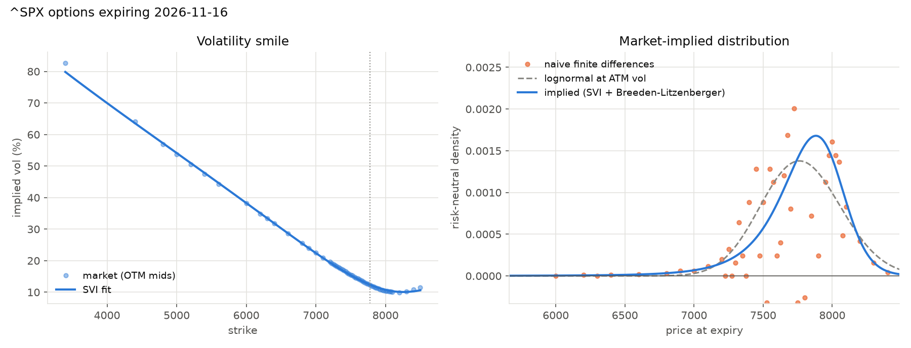
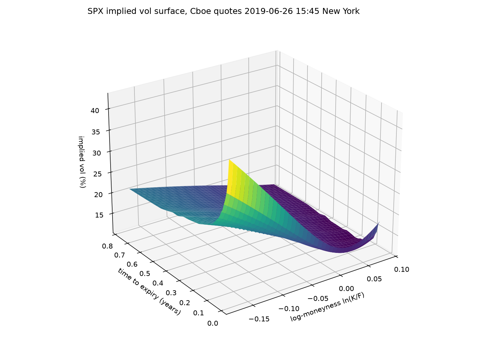
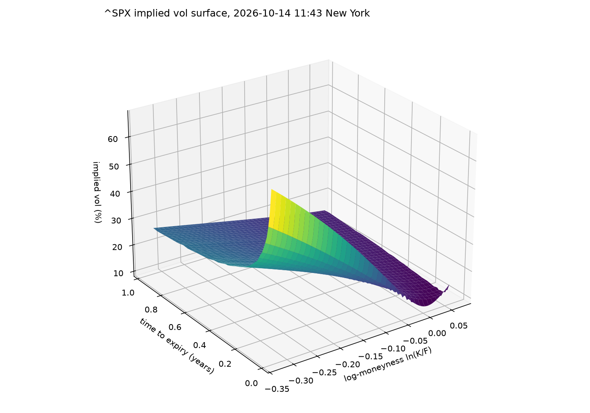

# Implied Distribution

**What the options market thinks the S&P 500 will be worth on a given date** — a full probability curve, recovered from option prices.


*Real Cboe SPX quotes. The market puts 4.8% on a 2-standard-deviation crash within a month; the Black-Scholes bell curve says 2.4%.*

Option prices encode a probability distribution. Breeden & Litzenberger (1978) showed it is the second derivative of the call price with respect to strike. Taking that derivative on raw quotes fails: on the real quotes above, naive finite differences (orange) go **negative at 29% of strikes**. This project solves that, checks it against a model where the true answer is known exactly, and checks it on every expiry of a real SPX option chain.

## Method

| Step | What | Why |
|---|---|---|
| 1. Forward | Weighted regression of put-call parity, `C − P = DF·F − DF·K` | Forward `F` and discount factor `DF` from prices alone — no rate or dividend assumptions |
| 2. Implied vols | Invert Black-76 on out-of-the-money mids (vectorised bisection) | OTM options are the liquid side; parity makes call and put vols identical |
| 3. Smooth | Fit Gatheral's SVI smile, `w(k) = a + b(ρ(k−m) + √((k−m)² + σ²))`, robust loss, arbitrage-free | Smoothing in vol space keeps the second derivative stable |
| 4. Density | `q(K) = ∂²C/∂K²` on the SVI call curve | Breeden-Litzenberger |

The SVI fit has two no-arbitrage guards. Real data needed both: without them, expiries with few call quotes produced probability mass up to 1.41.
- **Wing slopes ≤ 2** (Roger Lee's moment formula), by reparametrising `b`.
- **Durrleman's condition g(k) ≥ 0** (no butterfly arbitrage, equivalent to no negative density), penalised over the whole density grid, including the extrapolated wings.

The density grid spans ±16 ATM standard deviations. SPX's left tail is fat: at ±8, a live 6-month expiry lost 0.56% of its probability off the left edge of the grid.

All of it is in [`rnd/core.py`](rnd/core.py), about 170 lines.

## Validation

`python tests/test_rnd.py`: 15 tests, about 65 seconds on a MacBook Air (M-series); most of it is the 27-expiry surface fit.

**Known truth.** Noisy, tick-rounded quotes generated from a Heston stochastic-volatility model, whose density is exact by Fourier inversion.


| Check | Result |
|---|---|
| Heston reference: martingale, Black-Scholes limit, pdf = ∂²C/∂K² | errors < 1e-6 |
| Implied vol round trip | < 1e-8 |
| Forward and discount factor from noisy parity | within 0.1% |
| Flat vol → recovers lognormal | distance < 0.5% |
| Heston density from noisy quotes, 5 random seeds | total-variation distance ≈ 2%, no negative probabilities |
| Same, with stale wing quotes off by 50% | ≈ 1.8% |
| 2-σ crash probability | 6.69% recovered vs 6.75% true; lognormal says 2.65% |

**Real market.** Every SPXW expiry from 1 week to 1 year (27 expiries) in a Cboe 15:45 snapshot from 2019-06-26. There's no true density for real data, so the test checks what must hold:

| Check | Result on all 27 expiries |
|---|---|
| Probability mass | 0.9999–1.0000 |
| Negative probability mass | < 5e-7 |
| Mean of density vs forward (martingale) | within 0.6 bp |
| Implied interest rate from parity | 2.1–2.8%; Fed funds target was 2.25–2.50% |
| SVI fit error | 0.14–0.86 vol pts |
| ATM total variance rises with maturity (calendar no-arbitrage) | yes |
| Skew | negative on every expiry (−1.4 to −2.6); 2-σ crash probability 4.2–7.6% vs lognormal 2.3–2.7% |

The quotes are Cboe market data, published in the open-source [volkit](https://github.com/sitmo/volkit) project. They are not committed here: `python tests/data/download.py` fetches them (the tests do it automatically) and checks a SHA-256 hash. See [`tests/data`](tests/data).

## Run

```
pip install -r requirements.txt
python tests/data/download.py                                           # 2019 Cboe snapshot for --csv
python -m rnd --demo                                                    # known truth
python -m rnd --csv tests/data/spxw_20190626.csv --expiry 2019-07-26    # real quotes, offline
python -m rnd ^SPX                                                      # live, first expiry ≥ 30 days
python -m rnd ^SPX --expiry 2026-12-18
python -m rnd --csv tests/data/spxw_20190626.csv --surface --out surface.png  # implied vol surface
python -m rnd ^SPX --surface --out surface_live.png
```

Live data comes from Yahoo Finance (free, via yfinance). Run it during US market hours: 9:30–16:00 New York, which is 18:30–01:00 Almaty, or 19:30–02:00 after US clocks change on Nov 1. Outside those hours Yahoo still shows the last session's quotes: on a Saturday, 97–99% of contracts were two-sided and put-call parity on them gave a discount factor of 1.018. So the loader times the quotes by the newest trade in the chain (which also accounts for Yahoo's ~15-minute delay) and stops with a clear message if that trade is more than an hour old. `--csv` reads any file in Cboe's end-of-day format.

Output: forward, ATM vol, skew, excess kurtosis, the market's probability of a 2-standard-deviation drop versus the lognormal (Black-Scholes) answer, and the chart.

## Live SPX result

Yahoo Finance ^SPX quotes, 14 October 2026, about 10:59 New York time (Yahoo delays quotes ~15 minutes; SPX was 7,754). `python -m rnd ^SPX --out spx_live.png`:



The market puts **4.7% on a 2-standard-deviation drop** (below 7,220) by 16 November; the lognormal bell curve says 2.4%.

| Expiry | Days | Forward | ATM vol | Mass | Mean vs forward | SVI fit error | Implied rate | T-bill (13 Oct) | 2-σ crash: market / lognormal |
|---|---|---|---|---|---|---|---|---|---|
| 2026-11-16 | 33 | 7,778.8 | 12.4% | 0.9994 | 3 bp | 0.45 vol pts | 3.6% (12 strikes, ±2) | 4-wk 3.98% | 4.7% / 2.4% |
| 2026-12-18 | 65 | 7,801.9 | 13.4% | 0.9994 | 4 bp | 0.77 | 4.6% | 8-wk 4.05% | 5.0% / 2.4% |
| 2027-01-15 | 93 | 7,831.7 | 13.7% | 0.9991 | 6 bp | 0.77 | 4.8% | 13-wk 4.19% | 5.1% / 2.5% |
| 2027-04-16 | 184 | 7,908.6 | 15.0% | 0.9990 | 9 bp | 0.32 | 4.9% | 26-wk 4.35% | 5.5% / 2.6% |

T-bill: U.S. Treasury daily bill rates, coupon equivalent. Negative probability mass is below 3e-6 on every expiry, and ATM total variance rises with maturity (0.00139, 0.00319, 0.00477, 0.01134), so there is no calendar arbitrage. The implied rate comes from put-call parity alone and sits 0.5–0.65 points above T-bills at 2–6 months (continuously compounded vs coupon-equivalent; converting shifts it under 0.05). This is consistent with SPX box-spread rates usually running above Treasury yields, but only one day was measured here.

## Implied volatility surface

`--surface` fits SVI to every expiry in order of maturity. A calendar penalty, built like the Durrleman one, stops total variance from falling below the previous expiry on the strikes both quote. Fitted independently, the 2019 surface had total variance falling by up to 2.9e-3 (at ln(K/F) = −0.89, September 2019 expiries), even though the bid/ask quotes contain no calendar arbitrage at any strike. With the penalty there is no fall anywhere, and SVI fit error rises by at most 0.11 vol pts. The chart shows expiries up to 1 year on the strike range quoted by all of them, with total variance linear in T between expiries.



*2019 snapshot: 27 expiries fitted (3 under 7 days skipped); 26 up to 1 year shown over ln(K/F) −0.175 to 0.084.*



*Live ^SPX, 14 October 2026, 11:43 New York: 46 expiries fitted (5 under 7 days skipped, plus 2030 and 2031, which failed the mass and mean checks); 40 up to 1 year shown over ln(K/F) −0.325 to 0.066.*

## Limits

- **Risk-neutral, not real-world.** These probabilities include the price investors pay for crash insurance, so they overstate how often crashes actually happen.
- **SVI has one hump.** It can't represent a bimodal distribution, such as a single stock into earnings or a binary event.
- **Far wings at the minimum tick.** Options priced at $0.05–0.20 carry implied vol inflated by the tick floor. The arbitrage-free fit sits up to ~3 vol pts below them (right edge of the smile above); the density there is extrapolation.
- **Use ^SPX, not SPY.** SPX options are European; SPY options are American, which slightly biases parity and prices.
- **Yahoo data is delayed**, and Yahoo keeps showing the last bid/ask of contracts that stopped trading. On live SPX those were up to 1,549 points off put-call parity and pushed the implied rate to 38%, so the loader drops quotes not traded in 30 days.
- **Skew and kurtosis lean on the extrapolated tail.** They are moments of the whole density, including the far left wing beyond the last quote, so read them as model-dependent. The crash probability and the smile are better pinned by quotes.
- **Short expiries can have few strikes on Yahoo.** The 1-month chain below had only 12 strikes with both a call and a put, so its implied rate is noisy (about ±2 points).

## Next steps

1. **Fear index:** store the 2-σ crash probability daily and compare it with VIX.
2. **Implied vs realized:** compare the density's vol with realized vol. `gs_quant.timeseries.volatility` does this offline; the rest of gs-quant's market data needs Goldman Sachs institutional credentials.
