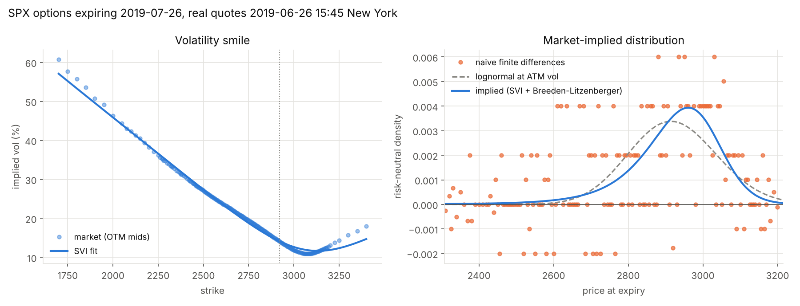
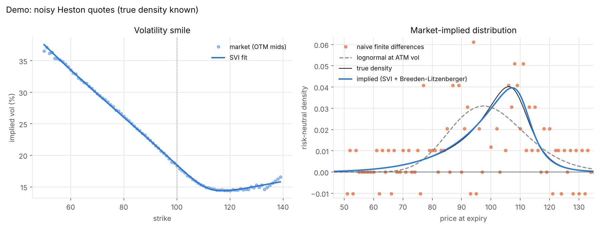

# Implied Distribution

**What the options market thinks the S&P 500 will be worth on a given date** — a full probability curve, recovered from option prices.



*Real Cboe SPX quotes. The market puts 4.7% on a 2-standard-deviation crash within a month; the Black-Scholes bell curve says 2.4%.*

Option prices encode a probability distribution. Breeden & Litzenberger (1978) showed it is the second derivative of the call price with respect to strike. Taking that derivative on raw quotes fails: on the real quotes above, naive finite differences (orange) go **negative at 27% of strikes**. This project solves that, checks it against a model where the true answer is known exactly, and checks it on every expiry of a real SPX option chain.

## Method

| Step | What | Why |
|---|---|---|
| 1. Forward | Weighted regression of put-call parity, `C − P = DF·F − DF·K` | Forward `F` and discount factor `DF` from prices alone — no rate or dividend assumptions |
| 2. Implied vols | Invert Black-76 on out-of-the-money mids (vectorised bisection) | OTM options are the liquid side; parity makes call and put vols identical |
| 3. Smooth | Fit Gatheral's SVI smile, `w(k) = a + b(ρ(k−m) + √((k−m)² + σ²))`, robust loss, arbitrage-free | Smoothing in vol space keeps the second derivative stable |
| 4. Density | `q(K) = ∂²C/∂K²` on the SVI call curve | Breeden-Litzenberger |

The SVI fit has two no-arbitrage guards. Real data needed both: without them, expiries with few call quotes produced probability mass up to 1.41.
- **Wing slopes ≤ 2** (Roger Lee's moment formula), by reparametrising `b`.
- **Durrleman's condition g(k) ≥ 0** (no butterfly arbitrage, equivalent to no negative density), penalised over the whole density grid, including the extrapolated wings.

All of it is in [`rnd/core.py`](rnd/core.py), about 170 lines.

## Validation

`python tests/test_rnd.py` (or `python -m pytest`), 9 tests, about 20 seconds.

**Known truth.** Noisy, tick-rounded quotes generated from a Heston stochastic-volatility model, whose density is exact by Fourier inversion.



| Check | Result |
|---|---|
| Heston reference: martingale, Black-Scholes limit, pdf = ∂²C/∂K² | errors < 1e-6 |
| Implied vol round trip | < 1e-8 |
| Forward and discount factor from noisy parity | within 0.1% |
| Flat vol → recovers lognormal | distance < 0.5% |
| Heston density from noisy quotes, 5 random seeds | total-variation distance ≈ 2%, no negative probabilities |
| Same, with stale wing quotes off by 50% | ≈ 1.8% |
| 2-σ crash probability | 6.65% recovered vs 6.75% true; lognormal says 2.65% |

**Real market.** Every SPXW expiry from 1 week to 1 year (27 expiries) in a Cboe 15:45 snapshot from 2019-06-26. There's no true density for real data, so the test checks what must hold:

| Check | Result on all 27 expiries |
|---|---|
| Probability mass | 0.998–1.000 |
| Negative probability mass | < 5e-7 |
| Mean of density vs forward (martingale) | within 21 bp |
| Implied interest rate from parity | 2.1–2.8%; Fed funds target was 2.25–2.50% |
| SVI fit error | 0.14–0.83 vol pts |
| ATM total variance rises with maturity (calendar no-arbitrage) | yes |
| Skew | negative on every expiry (−1.0 to −2.0); 2-σ crash probability 4.2–7.5% vs lognormal 2.3–2.7% |

The data is from the open-source [volkit](https://github.com/sitmo/volkit) project (BSD-3); see [`tests/data`](tests/data).

## Run

```
pip install -r requirements.txt
python -m rnd --demo                                                    # known truth
python -m rnd --csv tests/data/spxw_20190626.csv --expiry 2019-07-26    # real quotes, offline
python -m rnd ^SPX                                                      # live, first expiry ≥ 30 days
python -m rnd ^SPX --expiry 2026-12-18
```

Live data comes from Yahoo Finance (free, via yfinance). Run it during US market hours: 9:30–16:00 New York, which is 18:30–01:00 Almaty, or 19:30–02:00 after US clocks change on Nov 1. Outside those hours Yahoo returns empty bid/ask, and the loader stops with a clear message rather than use stale prices. `--csv` reads any file in Cboe's end-of-day format.

Output: forward, ATM vol, skew, excess kurtosis, the market's probability of a 2-standard-deviation drop versus the lognormal (Black-Scholes) answer, and the chart.

## Limits

- **Risk-neutral, not real-world.** These probabilities include the price investors pay for crash insurance, so they overstate how often crashes actually happen.
- **SVI has one hump.** It can't represent a bimodal distribution, such as a single stock into earnings or a binary event.
- **Far wings at the minimum tick.** Options priced at $0.05–0.20 carry implied vol inflated by the tick floor. The arbitrage-free fit sits up to ~3 vol pts below them (right edge of the smile above); the density there is extrapolation.
- **Use ^SPX, not SPY.** SPX options are European; SPY options are American, which slightly biases parity and prices.
- **Yahoo data is delayed** and occasionally has stale quotes; the robust fit tolerates a few.

## Next steps

1. **Live:** run on today's ^SPX chain and add the chart here.
2. **Fear index:** store the 2-σ crash probability daily and compare it with VIX.
3. **Implied vs realized:** compare the density's vol with realized vol. `gs_quant.timeseries.volatility` does this offline; the rest of gs-quant's market data needs Goldman Sachs institutional credentials.
